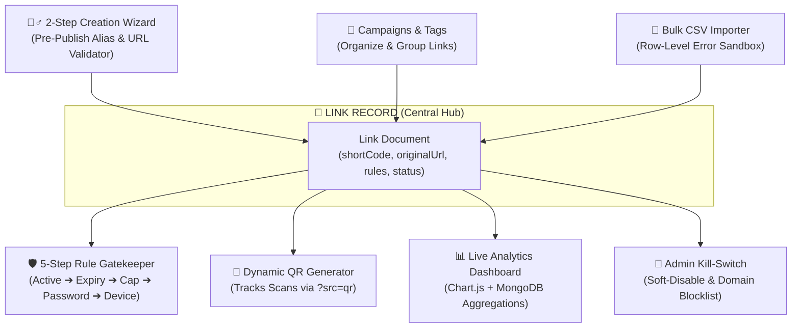
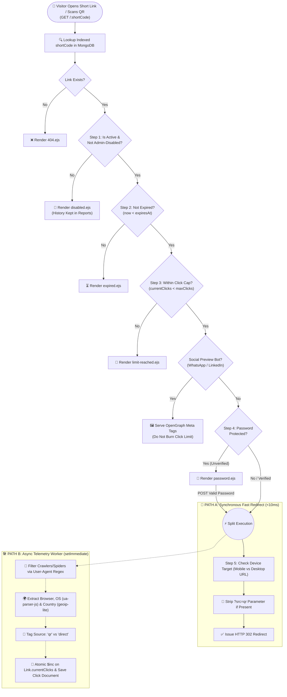
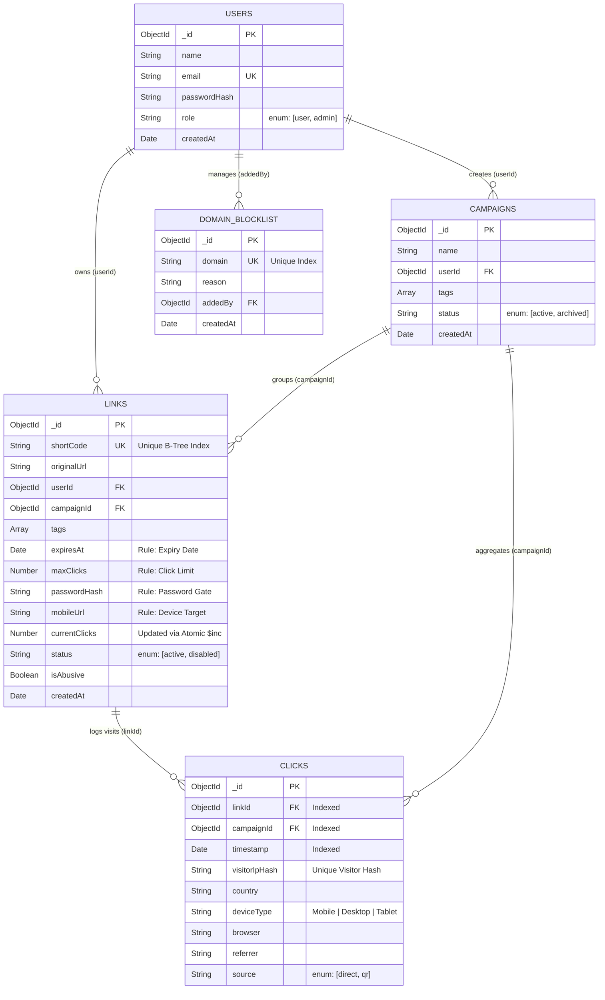

# 🔗 LinkPulse — High-Speed URL Governance, Routing & Analytics Engine

> **Tech Geeks Hackathon — Master Project Repository & Documentation (Round 1 & Round 2)**  
> An integrated link management, deterministic redirection, and live analytics platform built with **Node.js, Express.js, MongoDB (Mongoose), and EJS**.

---

## 📖 Table of Contents
1. [Project Overview & Main Goal](#-1-project-overview--main-goal)
2. [Problem Statement & Real-World Edge Cases](#-2-problem-statement--real-world-edge-cases)
3. [Solution Overview: The Unified Link Hub](#-3-solution-overview-the-unified-link-hub)
4. [System Architecture & Non-Blocking Data Flow](#-4-system-architecture--non-blocking-data-flow)
5. [Database ER Diagram & Mongoose Schemas](#-5-database-er-diagram--mongoose-schemas)
6. [Technology Stack & Why It Wins](#-6-technology-stack--why-it-wins)
7. [Core Implementation & Deterministic Rule Engine](#-7-core-implementation--deterministic-rule-engine)
8. [Role-Based Access Control (RBAC)](#-8-role-based-access-control-rbac)
9. [Standout Differentiators ("X-Factors")](#-9-standout-differentiators-x-factors)
10. [Round 1: PPT Slide-by-Slide Guide & GYAN Rules](#-10-round-1-ppt-slide-by-slide-guide--gyan-rules)
11. [Round 2: 16-Hour Development Roadmap & Folder Structure](#-11-round-2-16-hour-development-roadmap--folder-structure)
12. [Quick Start & Local Installation](#-12-quick-start--local-installation)
13. [5-Minute Live Demo Script (Round 2 Deliverable)](#-13-5-minute-live-demo-script-round-2-deliverable)
14. [Future Roadmap](#-14-future-roadmap)

---

## 🎯 1. Project Overview & Main Goal
Many basic URL shorteners only map a short code to a long URL. Real marketing and operations teams need **links, analytics, and governance** to work together in a single unified flow. A single link may belong to a campaign, expire next month, redirect mobile users to a different destination, and need to be disabled quickly if it turns out to be malicious.

**Main Goal:** Build an integrated platform that manages the full link lifecycle: **Creation $\rightarrow$ Redirection $\rightarrow$ Tracking $\rightarrow$ Analytics $\rightarrow$ Expiry or Takedown**, where every redirect, rule, and report is driven by real data rather than hardcoded values.

---

## 🚨 2. Problem Statement & Real-World Edge Cases
*(Addressing the Hackathon Hint: "IF EDGE CASE IS FIRST ONE")*

Standard URL shorteners fail in production because they overlook four critical engineering bottlenecks:

```
+-----------------------------------------------------------------------------------+
|                        WHY BASIC URL SHORTENERS BREAK                             |
+-----------------------------------------------------------------------------------+
|                                                                                   |
|  1. SLOW REDIRECTS (Sync Logging Bottleneck)                                      |
|     [Visitor Clicks] ──► [Wait for GeoIP + Device Parse + DB Write] ──► [Lag!]    |
|                                                                                   |
|  2. BOT & SOCIAL PREVIEW POLLUTION                                                |
|     [Share on WhatsApp] ──► [Preview Bot Crawls Link] ──► [Burns Click Limit!]    |
|                                                                                   |
|  3. LOST ANALYTICS ON EXPIRY / TAKEDOWN                                           |
|     [Link Expires / Admin Blocks] ──► [Hard Delete Row] ──► [Past Clicks Erased!] |
|                                                                                   |
|  4. CONCURRENT CLICK RACE CONDITIONS                                              |
|     [1 Click Left] ──► [5 Users Click Simultaneously] ──► [All 5 Let Through!]    |
+-----------------------------------------------------------------------------------+
```

1. **Edge Case 1 — The Redirect Latency Bottleneck:** Recording click data (IP lookup, Device/Browser parsing, Database write) synchronously *before* redirecting slows down the visitor's redirect speed (~450ms delay).
2. **Edge Case 2 — Bot & Preview Crawler Pollution:** Automated crawlers and social media preview bots (`WhatsApp`, `LinkedInBot`, `Twitterbot`) trigger fake visits, distorting campaign analytics and prematurely exhausting "Click Limits" before real humans can open the link.
3. **Edge Case 3 — Lifecycle & Takedown Traceability:** When a link expires, hits its click cap, or is disabled by an Admin for abuse, hard-deleting the record wipes out historical campaign analytics.
4. **Edge Case 4 — Concurrent Click Race Conditions:** If a link has `1` click remaining and `5` users click at the exact same millisecond, naive database checks allow all `5` through.

---

## 💡 3. Solution Overview: The Unified Link Hub
**LinkPulse** places the **Link Record** at the center of the platform, connecting Campaigns, Tags, Redirect Rules, QR Codes, and Live Click Telemetry.



### Key Platform Capabilities
* **2-Step Validated Creation Wizard:** Step 1 captures Destination URL and Custom/Auto Alias; Step 2 configures Expiry Dates, Click Caps, Passwords, and Device Targeting while surfacing duplicate alias or unsafe URL warnings *before* publishing.
* **Decoupled "Fire-and-Forget" Redirect Engine:** Executes an immediate `HTTP 302` redirect in `<10ms` for valid requests while offloading analytics extraction and database logging to an asynchronous background worker.
* **Deterministic Rule Gatekeeper:** Evaluates link status, expiration timestamp, click limits, password protection, and device routing in a strict, predictable sequence.
* **Soft-Delete Governance & Auditability:** Admins can instantly disable malicious links and block domains while keeping historical click reports 100% intact.

---

## ⚙️ 4. System Architecture & Non-Blocking Data Flow
To ensure **redirects stay fast while clicks are recorded reliably**, LinkPulse splits every incoming `GET /:shortCode` request into two execution paths:
* **Path A (Synchronous Fast Path — `<10ms`):** Checks rules and immediately redirects the user to the destination URL.
* **Path B (Asynchronous Worker Path — Non-Blocking):** Runs inside Node's `setImmediate()` event loop phase *after* the redirect response is sent.



---

## 🗄️ 5. Database ER Diagram & Mongoose Schemas
LinkPulse models clean relational connections across **5 MongoDB collections** using `mongoose.Schema.Types.ObjectId` references and B-Tree indexes.



---

## 💻 6. Technology Stack & Why It Wins

| Layer | Technology | Role in LinkPulse |
| :--- | :--- | :--- |
| **Backend & Routing** | **Node.js & Express.js** | Event-driven architecture for `<10ms` synchronous redirects and non-blocking background click logging. |
| **Database & ODM** | **MongoDB & Mongoose** | Unique B-Tree indexing on `shortCode`, relational `ObjectId` refs, atomic `$inc` counters, and `$group` Aggregation Pipelines. |
| **Frontend & Views** | **EJS, HTML5, CSS3, Bootstrap 5 / Tailwind, Vanilla JS** | Server-side rendered templates (`password.ejs`, `expired.ejs`, `dashboard.ejs`) with zero SPA build overhead. |
| **Analytics Charts** | **Chart.js** | Interactive time-series click trends, device/browser doughnut charts, and campaign performance bars. |
| **Core NPM Packages** | `qrcode`, `multer`, `csv-parser`, `ua-parser-js`, `geoip-lite`, `bcrypt`, `express-rate-limit` | QR generation, CSV bulk import, offline User-Agent & Geo-IP extraction, password hashing, and link creation rate limiting. |

### Why Express + Mongoose + EJS Beats Heavy Client-Side SPAs Here
1. **Native Server-Side Redirection:** URL shorteners are backend routing engines. When a link requires a password or has expired, Express renders `res.render('password-prompt')` in one network hop without client-side router lag or CORS complexity.
2. **Real-Time MongoDB Aggregations:** Mongoose's `Click.aggregate()` pipeline groups thousands of clicks by Date, Campaign, Device, and Browser in milliseconds to feed `Chart.js`.
3. **Zero Build-Step Failures:** Using EJS + CDN assets eliminates bundler issues during the hackathon, letting the team focus 100% on business logic and edge cases.

---

## 🧠 7. Core Implementation & Deterministic Rule Engine

### 1. Collision-Free Base62 Code Generator
Instead of slow random-string guessing, auto-generated aliases encode a counter/timestamp into **Base62** (`0-9, a-z, A-Z`), yielding $62^6 = 56.8\text{ Billion}$ unique 6-character combinations backed by a unique Mongoose index (`{ shortCode: 1 }, { unique: true }`).

### 2. Strict 5-Stage Rule Evaluation Order
Every `GET /:shortCode` request executes rules in this exact sequence:
$$\text{1. Active Status} \rightarrow \text{2. Expiry Date} \rightarrow \text{3. Click Limit} \rightarrow \text{4. Password Check} \rightarrow \text{5. Device Target}$$

### 3. Atomic Concurrency Protection
To prevent race conditions when multiple users click a link with `1` remaining click simultaneously, LinkPulse uses an atomic conditional update:
```javascript
const updatedLink = await Link.findOneAndUpdate(
  {
    shortCode: req.params.shortCode,
    status: 'active',
    $or: [{ maxClicks: null }, { $expr: { $lt: ['$currentClicks', '$maxClicks'] } }]
  },
  { $inc: { currentClicks: 1 } },
  { new: true }
);
```

---

## 👥 8. Role-Based Access Control (RBAC)

| Role | Access Scope & Capabilities |
| :--- | :--- |
| **Visitor (Anonymous)** | • Open short links and get redirected.<br>• Enter passwords on protected links.<br>• View fallback pages (`Expired`, `Limit Reached`, `Disabled`) with zero management access. |
| **User (Authenticated)** | • Create, edit, and organize own links via the 2-Step Wizard.<br>• Manage own Campaigns, Tags, Bulk CSV Imports, and downloadable QR codes.<br>• View live analytics dashboard scoped strictly to own links. |
| **Admin** | • Full visibility across all platform links, users, and global traffic metrics.<br>• **Instant Kill-Switch:** Disable abusive/malicious links immediately (`status: 'disabled'`) while keeping analytics intact.<br>• Manage the global **Domain Blocklist**. |

---

## 🌟 9. Standout Differentiators ("X-Factors")

1. **📱 QR Scan vs. Direct Click Attribution:** Generated QR codes automatically append `?src=qr` to the short URL. The redirect engine logs `source: 'qr'` in MongoDB and strips the parameter before redirecting, allowing the dashboard to compare physical poster scans against digital link clicks.
2. **🤖 Smart Social Media Preview Bypass:** Detects `WhatsApp`, `LinkedInBot`, and `Twitterbot` crawlers via `User-Agent`. Serves clean OpenGraph preview metadata without incrementing `currentClicks` or wasting the link's click cap.
3. **🧪 Interactive "Rule Simulator" Sandbox:** A built-in testing widget on the dashboard where users (and judges) can toggle simulated conditions (*Simulate Mobile OS*, *Simulate Expired Date*, *Simulate Max Clicks Reached*) to verify rule behavior in one click.
4. **📄 Pre-Publish Bulk CSV Validator:** Parses uploaded CSV files in memory, highlights duplicate aliases, malformed URLs, or blocked domains in red inside a preview table, and lets users import valid rows in one click.

---

## 📊 10. Round 1: PPT Slide-by-Slide Guide & GYAN Rules

### Mandatory Template Checklist (From Official "GYAN" Slide)
* [x] **Remove Placeholder Sketches:** Delete all grey placeholder text and hand-drawn smiley/wink drawings from the template.
* [x] **Delete Slides 7 & 8 of the Template:** Remove the `"WE CARE FOR YOU :-)"` and `"GYAN"` instruction slides before exporting.
* [x] **Keep Official Logos:** Retain the top-left and top-right logos on every slide.
* [x] **Strict Slide Limit:** Maximum of **8 content slides** (excluding the 1st cover page).
* [x] **No AI Tool Names in Tech Stack:** Only list real engineering technologies (`Node.js`, `Express`, `MongoDB`, `Mongoose`, `EJS`, `Chart.js`) that the team can explain.
* [x] **Export Format:** Submit strictly as a **`.pdf`** file.

### 8-Slide Presentation Blueprint
* **Slide 1 (Cover):** Team Name, Team Members Details & Roles, and LinkPulse Title.
* **Slide 2 (Problem Statement):** The 4 Real-World Edge Cases (Sync Redirect Lag, Bot Pollution, Lost History on Delete, Click Cap Race Conditions).
* **Slide 3 (Solution Overview):** Visual Central Hub diagram showing the `Link Record` connected to the 2-Step Wizard, Campaigns, Rule Engine, QR Generator, and Admin Kill-Switch.
* **Slide 4 (Tech Stack):** 4-Pillar breakdown (`EJS + HTML/CSS` $\rightarrow$ `Node.js + Express` $\rightarrow$ `MongoDB + Mongoose` $\rightarrow$ `Chart.js + NPM Utilities`).
* **Slide 5 (Implementation):** Visual 5-Step Rule Gatekeeper sequence + Base62 encoding + Atomic `$inc` counter + 3-Role RBAC.
* **Slide 6 (Diagrams):** One-Page System Architecture Flowchart showing the split between **Path A (Sync `<10ms` HTTP 302 Redirect)** and **Path B (Async `setImmediate` Click Worker)**.
* **Slide 7 (Database ER Schema):** Visual Mongoose Entity-Relationship diagram (`Users`, `Campaigns`, `Links`, `Clicks`, `DomainBlocklist`).
* **Slide 8 (X-Factors & Roadmap):** QR vs. Click Split, Social Bot Bypass, Rule Simulator, CSV Sandbox, and Future Scope.

---

## 🗺️ 11. Round 2: 16-Hour Development Roadmap & Folder Structure

### Project Directory Structure
```text
linkpulse/
├── config/
│   └── db.js                 # MongoDB & Mongoose connection setup
├── models/
│   ├── User.js               # User & RBAC schema ('user' | 'admin')
│   ├── Campaign.js           # Campaign organization schema
│   ├── Link.js               # Central Link Hub & Rules schema
│   ├── Click.js              # High-volume Click Telemetry schema
│   └── BlockedDomain.js      # Admin domain blocklist schema
├── middlewares/
│   ├── auth.js               # Session/JWT Role checks (User vs Admin)
│   └── rateLimiter.js        # express-rate-limit on link creation
├── utils/
│   ├── base62.js             # Collision-free Base62 shortCode generator
│   ├── botFilter.js          # User-Agent crawler & social preview detector
│   └── clickLogger.js        # Async setImmediate() telemetry worker
├── routes/
│   ├── redirectRoutes.js     # GET /:shortCode & POST /:shortCode/unlock
│   ├── linkRoutes.js         # 2-Step Wizard, QR code & CSV bulk import
│   ├── analyticsRoutes.js    # Mongoose Aggregation pipelines for Chart.js
│   └── adminRoutes.js        # Admin kill-switch & domain blocklist routes
├── views/                    # Server-Side EJS Templates
│   ├── dashboard.ejs         # Live Analytics, Campaigns & Rule Simulator
│   ├── wizard.ejs            # 2-Step Link Creation & Pre-Publish Validator
│   ├── bulk-import.ejs       # CSV Upload & Error Highlighting Sandbox
│   ├── admin.ejs             # Admin Governance & Abuse Takedown Panel
│   ├── password-prompt.ejs   # Visitor Password Gate
│   └── error-fallback.ejs    # Expired / Limit Reached / Disabled Notice
├── public/                   # Static CSS, client JS & downloadable assets
├── seed.js                   # Pre-populates realistic Campaigns, Links & Clicks
├── server.js                 # Express app entry point
└── package.json
```

### 4-Phase Execution Plan
| Phase | Timeline | Milestone | Key Deliverables |
| :--- | :--- | :--- | :--- |
| **Phase 1** | Hours 1–4 | **Core Schemas & Redirect Engine** | Mongoose models, Base62 generator, 2-step creation wizard with pre-publish validation, rate limiting, and `GET /:shortCode` rule evaluation. |
| **Phase 2** | Hours 5–7 | **Async Telemetry, Bot Filter & QR** | `setImmediate()` click logger, `ua-parser-js` + `geoip-lite` extraction, bot regex filter, atomic `$inc` counter, and `?src=qr` QR generator. |
| **Phase 3** | Hours 8–12 | **Live Dashboard & Campaigns** | Campaign & Tag CRUD, MongoDB `$group` aggregation queries, and interactive `Chart.js` graphs in `dashboard.ejs`. |
| **Phase 4** | Hours 13–16 | **Bulk CSV, Admin Panel & Polish** | CSV upload preview table (`multer` + `csv-parser`), Admin link kill-switch + domain blocklist, and `seed.js` demo data. |

---

## ⚡ 12. Quick Start & Local Installation

```bash
# 1. Clone the repository
git clone https://github.com/your-team/linkpulse.git
cd linkpulse

# 2. Install all required packages
npm install express mongoose ejs dotenv bcrypt express-session express-rate-limit qrcode multer csv-parser ua-parser-js geoip-lite

# 3. Create a .env file
cat <<EOT >> .env
PORT=3000
MONGO_URI=mongodb://127.0.0.1:27017/linkpulse
SESSION_SECRET=linkpulse_tech_geeks_secret
EOT

# 4. Seed realistic sample Campaigns, Links, and Click Events for the Judges Demo
node seed.js

# 5. Start the server
npm start
# Open http://localhost:3000 in your browser
```

---

## 🎤 13. 5-Minute Live Demo Script (Round 2 Deliverable)
The hackathon evaluation requires a **five-minute walkthrough of two scenarios** on a deployed/working core with pre-populated sample data:

### Scenario 1: Link Creation Wizard $\rightarrow$ Rule Enforcement $\rightarrow$ Live Analytics (2.5 Minutes)
1. **Pre-Publish Validation:** Open the **2-Step Wizard**, type an existing alias to show the live **"Duplicate Alias Warning"**, then pick a valid alias under the `"Tech Geeks Fest"` campaign.
2. **Rule Configuration:** Set a **Click Limit of 2** and **Password Protection**, then publish.
3. **QR Scan vs. Direct Click:**
   * Scan the generated **QR Code** on a phone (`Click #1` $\rightarrow$ Enter Password $\rightarrow$ Instant Redirect).
   * Open the short link on the laptop browser (`Click #2` $\rightarrow$ Instant Redirect).
   * Open the short link a 3rd time (`Click #3` $\rightarrow$ Automatically blocked by the **"Click Limit Reached"** EJS fallback screen).
4. **Live Dashboard:** Switch to the **Analytics Dashboard** and show the charts updating in real time with `1 QR Scan`, `1 Direct Click`, Device/Browser breakdown, and Campaign totals.

### Scenario 2: Bulk CSV Import $\rightarrow$ Admin Abuse Takedown & Traceability (2.5 Minutes)
1. **CSV Error Sandbox:** Upload a 10-row CSV file containing 2 intentional errors (`Row 3: Duplicate Alias`, `Row 7: Blocked Phishing Domain`).
2. **1-Click Valid Import:** Show the UI highlighting Rows 3 and 7 in red before publishing, and click **"Import 8 Valid Links"**.
3. **Admin Kill-Switch:** Switch to the **Admin Role View**, locate a flagged suspicious link, and toggle **"Disable Link"**.
4. **Traceability Proof:** Attempt to open the disabled short link (shows the **"Link Disabled for Safety"** screen immediately), then return to the Campaign Analytics page to prove that **100% of its historical clicks remain preserved** in the reports.

---

## 🔮 14. Future Roadmap
* **Custom Branded Domains (CNAME):** Allow workspaces to route links through custom domains (e.g., `links.brand.com/launch`).
* **Automated Capacity Webhooks:** Trigger Slack/Email alerts when a campaign link reaches 90% of its configured click limit.
* **Public Developer REST API:** API-key authenticated endpoints with tiered rate-limiting for external integrations.
* **Link-in-Bio Micro-Landing Pages:** Customizable public profile pages aggregating multiple campaign links and QR codes.